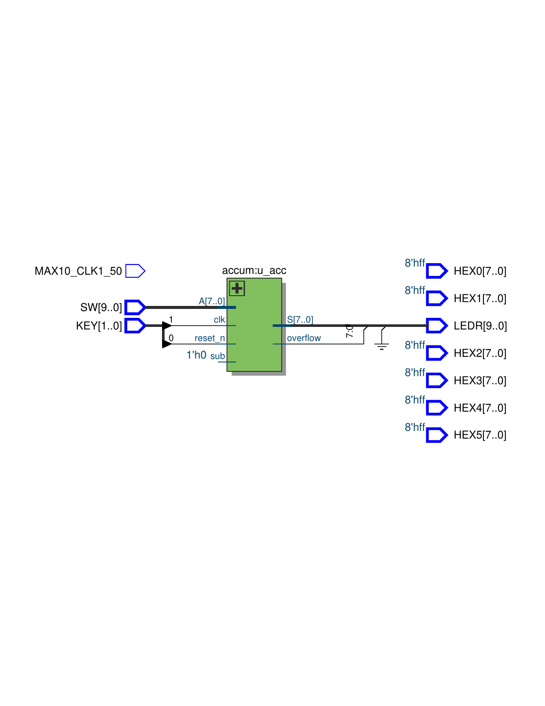
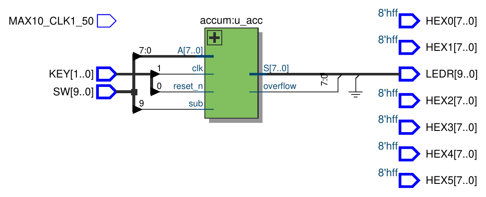
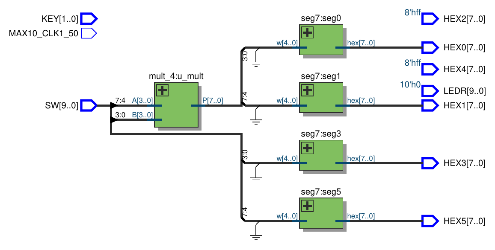
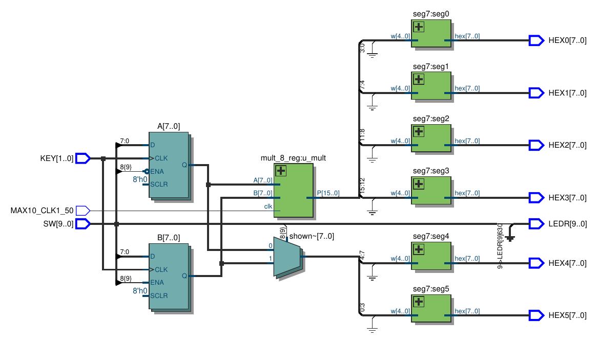
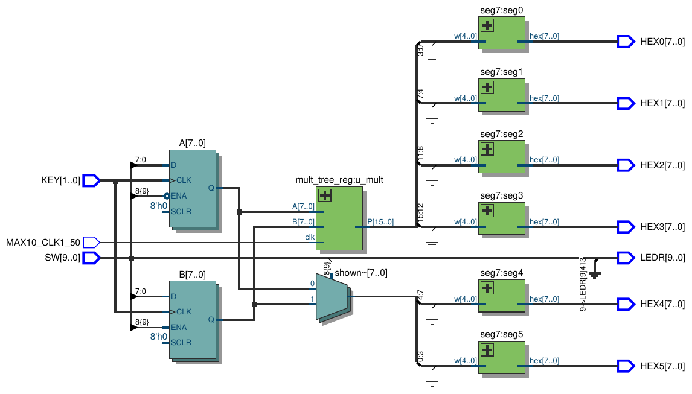

# Lab 5: Adders, Subtractors, and Multipliers

Board: **DE10-Lite**, MAX 10 `10M50DAF484C7G`. Verilog modules live in `verilog/`
(top level `main`). Every part is in `main.v`; uncomment the one to build. `sim/tb_lab5.v` is a self-checking testbench for all parts
(`iverilog -g2012 sim/tb_lab5.v verilog/{accum,ripple_carry,fa,adder_4,mult_4,mult_8,mult_tree,mult_8_reg,mult_tree_reg}.v`).

## Part I: 8-bit Accumulator

`S <= S + A` on each `KEY1` rising edge, with registered carry-out as `overflow`
(Figure 2). The adder is the `+` operator:

```verilog
module ripple_carry (
	input 		 Cin,
	input  [7:0] A, B,
	output 		 Cout,
	output [7:0] Sum
);

	 assign {Cout, Sum} = A + B + Cin;

endmodule
```

`accum.v` wraps it with the `S` and `overflow` registers (async active-low reset on
`KEY0`). Part I ties `sub` to 0.

**LEs:** 10, **registers:** 9, **Fmax:** 452.08 MHz (restricted to 250 MHz by the MAX 10
max I/O toggle rate on `KEY[1]`).

<!-- board photo: images/part1_board.jpg -->

### RTL view

The `accum` block driven by `SW[7:0]`, `KEY[1]` (clock) and `KEY[0]` (reset), with the
sum and overflow on `LEDR` ([PDF](images/part1_rtl.pdf)):




## Part II: Adder/Subtractor

Same accumulator with `add_sub` on `SW[9]`. Subtraction is `S + ~A + 1`: `sub`
XORs every bit of `A` and is also the carry in.

```verilog
ripple_carry u_add (
	.Cin(sub),
	.A(S),
	.B(A ^ {8{sub}}),
	.Cout(cout),
	.Sum(sum)
);
...
S        <= sum;
overflow <= cout ^ sub;
```

`overflow` is the carry out when adding and the borrow (`A > S`, unsigned) when
subtracting: the adder carry out is 1 when there is *no* borrow, hence the XOR with `sub`.

**LEs:** 20, **registers:** 9, **Fmax:** 372.30 MHz (restricted to 250 MHz by I/O).

<!-- board photo: images/part2_board.jpg -->

### RTL view

Same `accum` block as Part I, with `SW[9]` now driving `sub` ([PDF](images/part2_rtl.pdf)):




## Part III: 4x4 Array Multiplier

Figure 4, built from `fa` modules via a four-bit `adder_4` (`mult_4.v`). Row 0 is the
first partial product `A & B[0]`. Each later row adds `A & B[i]` to the previous row's sum
shifted right one place, and the low bit of each row is `P[i]`. The last row's sum and
carry give `P[7:4]`.

```verilog
module fa (
	input  a, b, ci,
	output s, co
);

	assign s  = a ^ b ^ ci;
	assign co = (a & b) | (ci & (a ^ b));

endmodule
```

**LEs:** 60 (includes the three seg7 decoders), purely combinational.

Functional simulation (`tb_lab5.v`) checks all 256 `A`/`B` pairs against `*`.

<!-- board photo: images/part3_board.jpg -->

### RTL view

`mult_4` takes `A` and `B` from the switches; `A`, `B` and the two product nibbles each
drive a `seg7` ([PDF](images/part3_rtl.pdf)):




## Part IV: 8x8 Registered Multiplier (adder rows)

Same structure as Part III but each row is an 8-bit adder written with `+`
(`ripple_carry`, `mult_8.v`), wrapped in `mult_8_reg` which registers `A`, `B` (input
flops) and `P` (output flops) as in Figure 6. Clocked from `MAX10_CLK1_50`.

**LEs:** 198 (total design, includes the operand-load registers and six seg7 decoders),
**registers:** 48, **Fmax:** 78.32 MHz.

<!-- board photo: images/part4_board.jpg -->

### RTL view

The `A` and `B` load registers (enabled by `SW[9]`, clocked by `KEY[1]`) feed `mult_8_reg`.
A 2-to-1 mux picks which operand goes to `HEX5-4`, and `P` drives `HEX3-0`
([PDF](images/part4_rtl.pdf)):




## Part V: 8x8 Registered Multiplier (adder tree)

`mult_tree.v`: eight shifted partial products added in a tree (4 adders, then 2, then 1)
instead of the row-by-row chain. Same register wrapper (`mult_tree_reg.v`).

**LEs:** 199, **registers:** 48, **Fmax:** 145.79 MHz.

The tree has three adder levels in series rather than eight, which is why it is almost
twice as fast as Part IV for about the same logic.

<!-- board photo: images/part5_board.jpg -->

### RTL view

Same load registers and display wiring as Part IV, with `mult_tree_reg:u_mult` in place of
`mult_8_reg` ([PDF](images/part5_rtl.pdf)):




---

## Notes

- Fmax numbers are from the Slow 1200mV 85C model in the Timing Analyzer.
- Parts I/II treat `KEY[1]` as a clock, so Quartus reports an Fmax for it; it is limited
  by the I/O toggle rate, not the adder.
- Part III has no clock, so there is no Fmax; read the longest path from the
  Timing Analyzer if the report needs it.
- `KEY[1]` is used as a clock to load `A`/`B` in Parts IV/V. This crosses into the 50 MHz
  domain, but the values only change on a button press and the multiplier output is
  re-registered, so it settles within a few clocks.
