# Lab 7: Very Simple Microprocessor (VSM)

Board: **DE10-Lite**, MAX 10 `10M50DAF484C7G`. Verilog modules live in `verilog/`
(top level `main`). Directions: `Lab_7_Directions.pdf`.

A 4-bit accumulator microprocessor. A shared 4-bit internal bus (`w_IB_BUS`) connects
the registers, ALU, input and output. Each source drives the bus through tri-state
buffers, and the FSM decides which one is enabled in each phase. The clock is a switch
(`SW[9]`), so the CPU can be single-stepped.

| Signal | Pin | Function |
|---|---|---|
| `SW[9]` | switch | manual clock (`w_clock`) |
| `SW[8]` | switch | reset (`w_reset`) |
| `SW[3:0]` | switches | user input (`InRegister`) |
| `LEDR[3:0]` | LEDs | output register |
| `LEDR[9]` | LED | ALU carry |
| `HEX0` | 7-seg | internal bus |
| `HEX1` | 7-seg | Accumulator A |
| `HEX2` | 7-seg | Accumulator B |
| `HEX4` | 7-seg | user input switches |
| `HEX5` | 7-seg | output register |

**Fit results (MAX 10, `10M50DAF484C7G`):** 85 logic elements (< 1 %), 27 registers, 99 pins, 0 memory bits.

<p align="center">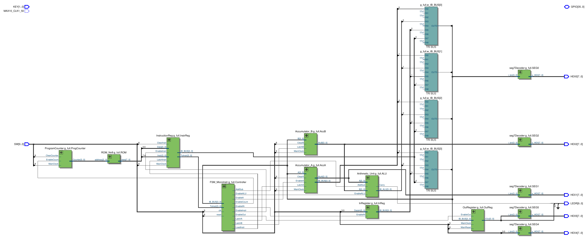<br><em>Top level RTL Viewer</em></p>
<!-- images/flow_summary.png : Flow Summary -->

## Instruction set

Each ROM word is 8 bits: `{instruction[3:0], data[3:0]}`.

| Opcode | Mnemonic | Operation |
|---|---|---|
| `0000` | NOP | nothing |
| `0001` | ADD d | `A <- A + d` |
| `0010` | SUB d | `A <- d - A` (data is loaded into B, ALU computes `B - A`; borrow shows on LEDR[9]) |
| `0011` | OUT | `Out <- A` |
| `0100` | IN | `A <- switches` |
| `0101` | LDA d | `A <- d` |

## Phases

Every instruction takes 4 clocks after reset leaves `IDLE`.

| Phase | Name | What happens |
|---|---|---|
| 1 | Fetch | `LoadInstr`: ROM word is latched into the instruction register |
| 2 | Decode | `EnableCount` (PC + 1) and `EnableInstr` (data nibble on the bus) |
| 3 | Execute A | depends on the instruction |
| 4 | Execute B | depends on the instruction |

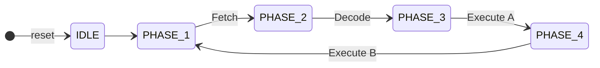

<!-- images/fsm_state_diagram.png : hand-drawn version, optional -->

## Modules

### Accumulator_A

Register that holds the accumulator value (A). On the rising clock edge it clears when `ClearA` is high, otherwise it loads the bus when `LatchA` is high. `AluA` always feeds the ALU (and HEX1). `EnableA` puts the stored value back on the internal bus through a tri-state buffer, otherwise the output is high-Z. In `main.v` the `A` input is wired to the bus itself.

**Code**

```verilog
`default_nettype none

module Accumulator_A #
(
	parameter N = 4
)
(
	input MainClock,
	input ClearA,
	input LatchA,
	input EnableA,
	input [N-1:0] A,
	output [N-1:0] IB_BUS,
	output reg [N-1:0] AluA
);

	// Sequential Logic
	always @(posedge MainClock) begin
		if(ClearA)
			AluA <= {N{1'b0}};
		else begin
			if(LatchA)
				AluA <= A;
		end
	end
	
	// Combinational Logic
	assign IB_BUS = (EnableA) ? AluA : {N{1'bz}};

endmodule

`default_nettype wire
```

**Test (instantiation in `main.v`)**

```verilog
Accumulator_A AccA(
    .MainClock(w_clock),
    .ClearA(w_reset),
    .LatchA(w_LatchA),      // FSM CONTROL
    .EnableA(w_EnableA),    // FSM CONTROL
    .A(w_IB_BUS),
    .IB_BUS(w_IB_BUS),
    .AluA(w_AluA)
  );
```

<p align="center">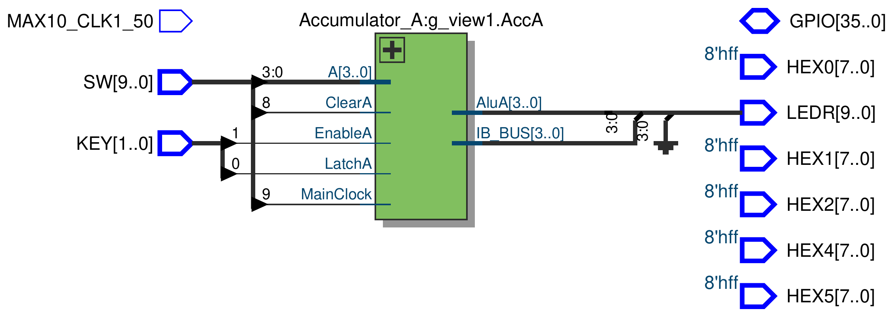<br><em>Accumulator_A RTL Viewer</em></p>

### Accumulator_B

Second register, used as the other ALU operand. It loads from the bus on `LatchB` and clears on reset. It has no bus output, `AluB` only goes to the ALU and HEX2. The FSM loads the instruction's data nibble into B during phase 3 of ADD and SUB.

**Code**

```verilog
`default_nettype none

module Accumulator_B #
(
	parameter N = 4
)
(
	input MainClock,
	input ClearB,
	input LatchB,
	input [N-1:0] B,
	output reg [N-1:0] AluB
);


	always @(posedge MainClock) begin
		if (ClearB)
			AluB <= {N{1'b0}};
		else
			if (LatchB)
				AluB <= B;
	end

endmodule

`default_nettype wire
```

**Test (instantiation in `main.v`)**

```verilog
Accumulator_B AccB (
    .MainClock(w_clock),
    .ClearB(w_reset),
    .LatchB(w_LatchB),  // FSM CONTROL
    .B(w_IB_BUS),
    .AluB(w_AluB)
  );
```

<p align="center">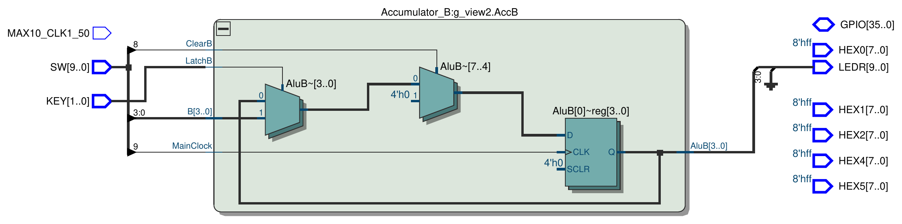<br><em>Accumulator_B RTL Viewer</em></p>

### Arithmetic_Unit

Combinational adder/subtractor. With `AddSub = 0` it computes `B + A`, with `AddSub = 1` it computes `B - A`. The result is kept as a 5 bit value `{Carry, IB_ALU}` so the carry (or borrow) comes out as its own bit, shown on LEDR[9]. When `EnableALU` is low the bus output is high-Z and carry is 0. Because the data nibble sits in B, SUB ends up as `d - A`.

**Code**

```verilog
`default_nettype none

module Arithmetic_Unit #
(
	parameter N = 4
)
(
	input EnableALU,
	input AddSub,
	input [N-1:0] A,
	input [N-1:0] B,
	output reg Carry,
	output reg [N-1:0] IB_ALU
);

	always @(*) begin
		if (EnableALU) begin
			if (AddSub) begin
				{Carry, IB_ALU} = B - A;
			end
			else begin
				{Carry, IB_ALU} = B + A;
			end
		end
		else begin 
			// set bus to Z
			IB_ALU = {N{1'bz}};
			Carry = 1'b0;
		end
	end
	
endmodule

`default_nettype wire
```

**Test (instantiation in `main.v`)**

```verilog
Arithmetic_Unit ALU (
    .EnableALU(w_EnableALU),    // FSM CONTROL
    .AddSub(w_AddSub),        // FSM CONTROL
    .A(w_AluA),
    .B(w_AluB),
    .Carry(w_carry),
    .IB_ALU(w_IB_BUS)
  );
```

<p align="center">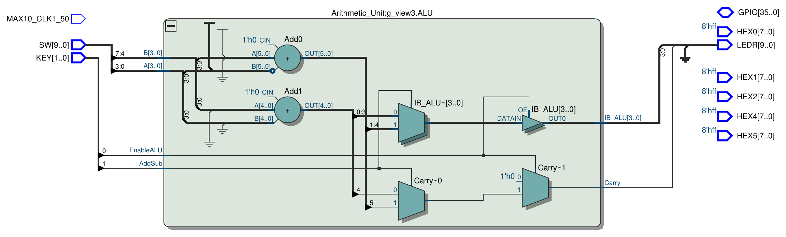<br><em>Arithmetic_Unit RTL Viewer</em></p>

### InRegister

Tri-state buffer between the user switches (`SW[3:0]`) and the internal bus. When `EnableIN` is high the switches drive the bus, otherwise the output floats. It has no clock since the switches are read live.

**Code**

```verilog
`default_nettype none

module InRegister #
(
	parameter N = 4
)
(
	input EnableIN,
	input [N-1:0] DataIn,
	output [N-1:0] IB_BUS
);

	assign IB_BUS = (EnableIN) ? DataIn : {N{1'bz}};

endmodule

`default_nettype wire
```

**Test (instantiation in `main.v`)**

```verilog
InRegister InReg(
    .EnableIN(w_EnableIN),  // FSM CONTROL
    .DataIn(w_user_input),
    .IB_BUS(w_IB_BUS)
  );
```

<p align="center">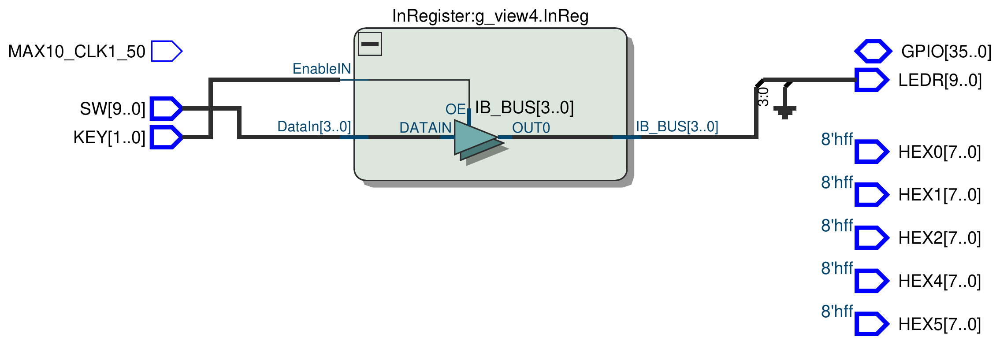<br><em>InRegister RTL Viewer</em></p>

### OutRegister

4 bit register that holds the output value. It loads the bus on the clock edge when `EnableOut` is high and clears on reset. `rOut` drives LEDR[3:0] and HEX5.

**Code**

```verilog
`default_nettype none

module OutRegister #
(
	parameter N = 4
)
(
	input MainClock,
	input MainReset,
	input EnableOut,
	input [N-1:0] IB_BUS,
	output reg [N-1:0] rOut
);

	always @(posedge MainClock) begin
		if (MainReset) begin
			rOut <= {N{1'b0}};
		end
		else begin 
			if (EnableOut)
				rOut <= IB_BUS;
		end
	end

endmodule

`default_nettype wire
```

**Test (instantiation in `main.v`)**

```verilog
OutRegister OutReg(
    .MainClock(w_clock),
    .MainReset(w_reset),
    .EnableOut(w_EnableOut),  // FSM CONTROL
    .IB_BUS(w_IB_BUS),
    .rOut(w_rOut)
  );
```

<p align="center">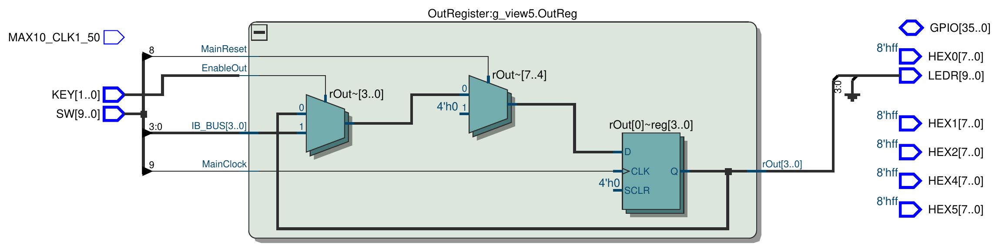<br><em>OutRegister RTL Viewer</em></p>

### InstructionReg

Stores the ROM word when `LatchInstr` is high: the opcode nibble goes to `ToInstr` (read by the FSM) and the data nibble goes to an internal register. When `EnableInstr` is high the stored data nibble is put on the internal bus. Both are cleared by reset.

**Code**

```verilog
`default_nettype none

module InstructionReg #
(
	parameter N = 4
)
(
	input MainClock,
	input ClearInstr,
	input LatchInstr,
	input EnableInstr,
	input [N-1:0] Data,
	input [N-1:0] Instr,
	output reg [N-1:0] ToInstr,
	output [N-1:0] IB_BUS
);

	reg [N-1:0] r_data;
	
	// Sequential logic
	always @(posedge MainClock) begin
		if (ClearInstr) begin
			ToInstr <= {N{1'b0}};
			r_data  <= {N{1'b0}};
		end
		else if (LatchInstr) begin
			ToInstr <= Instr;
			r_data  <= Data;
		end
	end
	
	// Combinational
	assign IB_BUS = (EnableInstr) ? r_data : {N{1'bz}};
	
endmodule

`default_nettype wire
```

**Test (instantiation in `main.v`)**

```verilog
InstructionReg InstrReg(
    .MainClock(w_clock),
    .ClearInstr(w_reset),
    .LatchInstr(w_LoadInstr),    // FSM CONTROL
    .EnableInstr(w_EnableInstr),   // FSM CONTROL
    .Data(w_data),
    .Instr(w_instruction),
    .ToInstr(w_ToInstr),
    .IB_BUS(w_IB_BUS)
  );
```

<p align="center">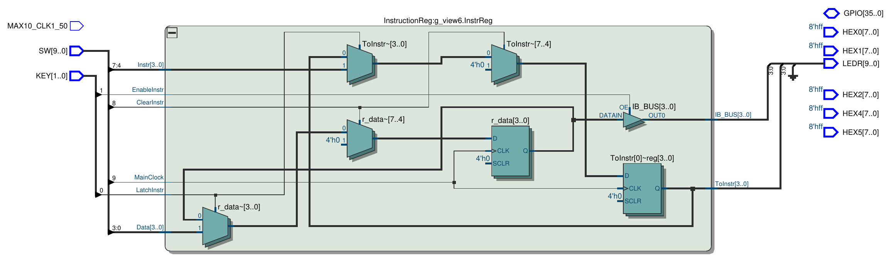<br><em>InstructionReg RTL Viewer</em></p>

### ProgramCounter

4 bit counter that adds 1 on each clock where `EnableCount` is high and clears on reset. The ROM only uses the lower 3 bits (`w_counter[2:0]`), so the program wraps back to address 0 after 8 words.

**Code**

```verilog
`default_nettype none

module ProgramCounter #
(
	parameter N = 4
)
(
	input MainClock,
	input EnableCount,
	input ClearCounter,
	output reg [N-1:0] Counter
);

	always @(posedge MainClock) begin
		if (ClearCounter)
			Counter <= {N{1'b0}};
		else if (EnableCount)
			Counter <= Counter + 1;
	end

endmodule

`default_nettype wire
```

**Test (instantiation in `main.v`)**

```verilog
ProgramCounter ProgCounter (
    .MainClock(w_clock),
    .EnableCount(w_EnableCount),  // FSM CONTROL
    .ClearCounter(w_reset),
    .Counter(w_counter)
  );
```

<p align="center">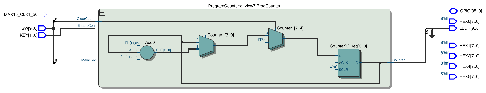<br><em>ProgramCounter RTL Viewer</em></p>

### ROM_Nx8

Asynchronous 8 word by 8 bit ROM. The program is loaded in an `initial` block and `data` follows `address` combinationally. `ramstyle = "logic"` keeps it in logic elements (the fit report shows 0 memory bits). Each word is `{opcode, data}`.

Program stored in the ROM:

| Addr | Word | Instruction | Result |
|---|---|---|---|
| 0 | `55` | LDA 5 | A = 5 |
| 1 | `12` | ADD 2 | A = 7 |
| 2 | `30` | OUT | Out = 7 |
| 3 | `28` | SUB 8 | A = 8 - 7 = 1 |
| 4 | `30` | OUT | Out = 1 |
| 5 | `40` | IN | A = switches |
| 6 | `13` | ADD 3 | A = switches + 3 |
| 7 | `30` | OUT | Out = switches + 3 |

After address 7 the counter wraps and the program repeats.

**Code**

```verilog
`default_nettype none

module ROM_Nx8 #
(
	parameter N = 8
)
(
	input [$clog2(N)-1:0] address,
	output reg [7:0] data
);

	(* ramstyle = "logic" *) reg [7:0] rom [0:N-1];
	
	// Initialize memory -> your asm instructions
	initial begin
		rom[0] = 8'h55;
		rom[1] = 8'h12;
		rom[2] = 8'h30;
		rom[3] = 8'h28;
		rom[4] = 8'h30;
		rom[5] = 8'h40;
		rom[6] = 8'h13;
		rom[7] = 8'h30;
		// maximum 16 instructions
	end
	
	// Combinational Logic (async)
	always @(*) begin
		data = rom[address];
	end

endmodule

`default_nettype wire
```

**Test (instantiation in `main.v`)**

```verilog
wire [7:0] w_rom_data;

  ROM_Nx8 ROM (
    .address(w_counter[2:0]),
    .data(w_rom_data)
  );

  assign {w_instruction, w_data} = w_rom_data;
```

<p align="center">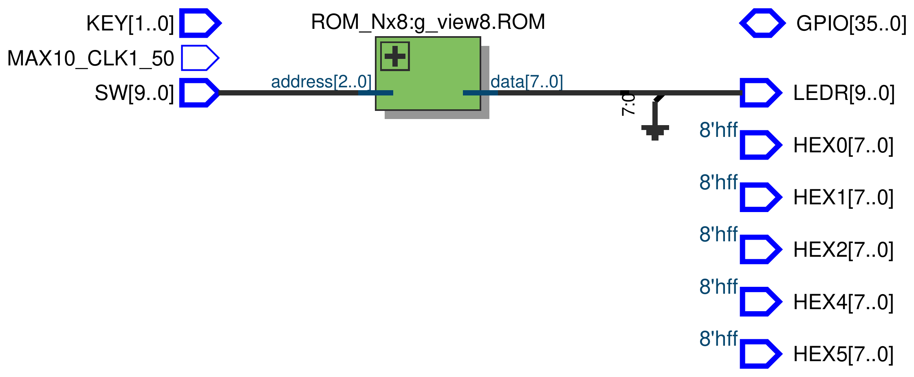<br><em>ROM_Nx8 RTL Viewer</em></p>

### FSM_MicroInstr

Control unit. It is a 5 state machine (`IDLE`, `PHASE_1` to `PHASE_4`) written as three blocks: a state register, next-state logic and output logic. Reset sends it to `IDLE`, the next clock moves to `PHASE_1`, and after that it just loops 1 -> 2 -> 3 -> 4 -> 1. Phases 1 and 2 are the same for every instruction. In phases 3 and 4 the outputs also depend on the opcode (`ToInstr`). Opcodes `0110` to `1111` are not decoded, so they do nothing (same as NOP).

Control signals per phase (1 = asserted):

| Phase | Instr | `LoadInstr` | `EnableInstr` | `EnableCount` | `LatchA` | `EnableA` | `LatchB` | `EnableALU` | `AddSub` | `EnableIN` | `EnableOut` |
|---|---|---|---|---|---|---|---|---|---|---|---|
| 1 Fetch | all | 1 | 0 | 0 | 0 | 0 | 0 | 0 | 0 | 0 | 0 |
| 2 Decode | all | 0 | 1 | 1 | 0 | 0 | 0 | 0 | 0 | 0 | 0 |
| 3 Execute A | NOP | 0 | 0 | 0 | 0 | 0 | 0 | 0 | 0 | 0 | 0 |
| 3 Execute A | ADD | 0 | 1 | 0 | 0 | 0 | 1 | 0 | 0 | 0 | 0 |
| 3 Execute A | SUB | 0 | 1 | 0 | 0 | 0 | 1 | 0 | 0 | 0 | 0 |
| 3 Execute A | OUT | 0 | 0 | 0 | 0 | 1 | 0 | 0 | 0 | 0 | 1 |
| 3 Execute A | IN | 0 | 0 | 0 | 1 | 0 | 0 | 0 | 0 | 1 | 0 |
| 3 Execute A | LDA | 0 | 1 | 0 | 1 | 0 | 0 | 0 | 0 | 0 | 0 |
| 4 Execute B | NOP | 0 | 0 | 0 | 0 | 0 | 0 | 0 | 0 | 0 | 0 |
| 4 Execute B | ADD | 0 | 0 | 0 | 1 | 0 | 0 | 1 | 0 | 0 | 0 |
| 4 Execute B | SUB | 0 | 0 | 0 | 1 | 0 | 0 | 1 | 1 | 0 | 0 |
| 4 Execute B | OUT | 0 | 0 | 0 | 0 | 0 | 0 | 0 | 0 | 0 | 0 |
| 4 Execute B | IN | 0 | 0 | 0 | 0 | 0 | 0 | 0 | 0 | 0 | 0 |
| 4 Execute B | LDA | 0 | 0 | 0 | 0 | 0 | 0 | 0 | 0 | 0 | 0 |

**Code**

```verilog
`default_nettype none

module FSM_MicroInstr #
(
	parameter N = 4
)
(
	input clk,
	input reset,
	input [N-1:0] IB_BUS,
	
	output reg LatchA,
	output reg EnableA,
	output reg LatchB,
	output reg EnableALU,
	output reg AddSub,
	output reg EnableIN,
	output reg EnableOut,
	output reg LoadInstr,
	output reg EnableInstr,
	input [N-1:0]	ToInstr,
	output reg EnableCount
);

	reg [2:0] state, next_state;

	// States
	localparam [2:0] IDLE = 3'd0, PHASE_1 = 3'd1, PHASE_2 = 3'd2, PHASE_3 = 3'd3, PHASE_4 = 3'd4;

	// 1. State Register (sequential)
	always @(posedge clk) begin
		if(reset)
			state <= IDLE;
		else
			state <= next_state;
	end
	
	// 2. Next-State Logic (combinational)
	always @(*) begin
		
		next_state = state; // default: hold state
	
		case(state)
		
			IDLE: 
				begin		
					// Move to FETCH
					next_state = PHASE_1;
				end
			
			// FETCH Instruction
			PHASE_1:
				begin
					// Move to DECODE
					next_state = PHASE_2;
				end
			
			// DECODE Instruction	
			PHASE_2:
				begin
					// Move to EXECUTE A
					next_state = PHASE_3;
				end
				
			// EXECUTE A Instruction
			PHASE_3:
				begin
					// Move to EXECUTE B
					next_state = PHASE_4;
				end
			
			// EXECUTE B Instruction	
			PHASE_4:
				begin
					// Move to FETCH
					next_state = PHASE_1;
				end
				
			default: ;// None
		
		endcase
	end
	
	// 3. Output Logic (combinational)
	
	always @(*) begin
	
		// default all signals are zero
		LoadInstr 	= 1'b0;
		EnableInstr = 1'b0;
		LatchB 		= 1'b0;
		LatchA 		= 1'b0;
		EnableALU 	= 1'b0;
		EnableCount = 1'b0;
		AddSub		= 1'b0;
		EnableIN		= 1'b0;
		EnableA		= 1'b0;
		EnableOut	= 1'b0;
	
		case(state)
		
			IDLE: 
				begin
					// Initialize things if needed
				end
			
			// FETCH Instruction
			PHASE_1:
				begin
					// same sequence for all asm instructions
					LoadInstr = 1'b1;
				end
			
			// DECODE Instruction	
			PHASE_2:
				begin
					// same sequence for all asm instructions
					EnableCount = 1'b1;
					EnableInstr = 1'b1;
				end
				
			// EXECUTE Instruction
			PHASE_3:
				begin
					
					case(ToInstr)
						
						4'b0000: // NOP
							begin
								// do nothing
							end
							
						4'b0001: // ADD
							begin
								LatchB 		= 1'b1;
								EnableInstr = 1'b1;
							end
							
						4'b0010: // SUB
							begin
								LatchB 		= 1'b1;
								EnableInstr = 1'b1;
							end
							
						4'b0011: // OUT
							begin
								EnableOut 	= 1'b1;
								EnableA 		= 1'b1;
							end	
						
						4'b0100: // IN
							begin
								LatchA 	= 1'b1;
								EnableIN = 1'b1;
							end
						
						4'b0101: // LDA
							begin
								LatchA 		= 1'b1;
								EnableInstr = 1'b1;
							end
						
					endcase
					
				end
			
			// EXECUTE Instruction	
			PHASE_4:
				begin
					
					case(ToInstr)
						
						4'b0000: // NOP
							begin
								// do nothing
							end
							
						4'b0001: // ADD
							begin
								LatchA 		= 1'b1;
								EnableALU 	= 1'b1;
							end
							
						4'b0010: // SUB
							begin
								LatchA 		= 1'b1;
								EnableALU 	= 1'b1;
								AddSub 		= 1'b1;
							end
							
						4'b0011: // OUT
							begin
								// do nothing
							end
							
						4'b0100: // IN
							begin
								// do nothing
							end
							
						4'b0101: // LDA
							begin
								// do nothing
							end
						
					endcase
					
				end
		
		endcase
	end

endmodule

`default_nettype wire
```

**Test (instantiation in `main.v`)**

```verilog
FSM_MicroInstr Controller (
    .clk(w_clock),
    .reset(w_reset),
    .IB_BUS(w_IB_BUS),
    .LatchA(w_LatchA),
    .EnableA(w_EnableA),
    .LatchB(w_LatchB),
    .EnableALU(w_EnableALU),
    .AddSub(w_AddSub),
    .EnableIN(w_EnableIN),
    .EnableOut(w_EnableOut),
    .LoadInstr(w_LoadInstr),
    .EnableInstr(w_EnableInstr),
    .ToInstr(w_ToInstr),
    .EnableCount(w_EnableCount)
  );
```

<p align="center">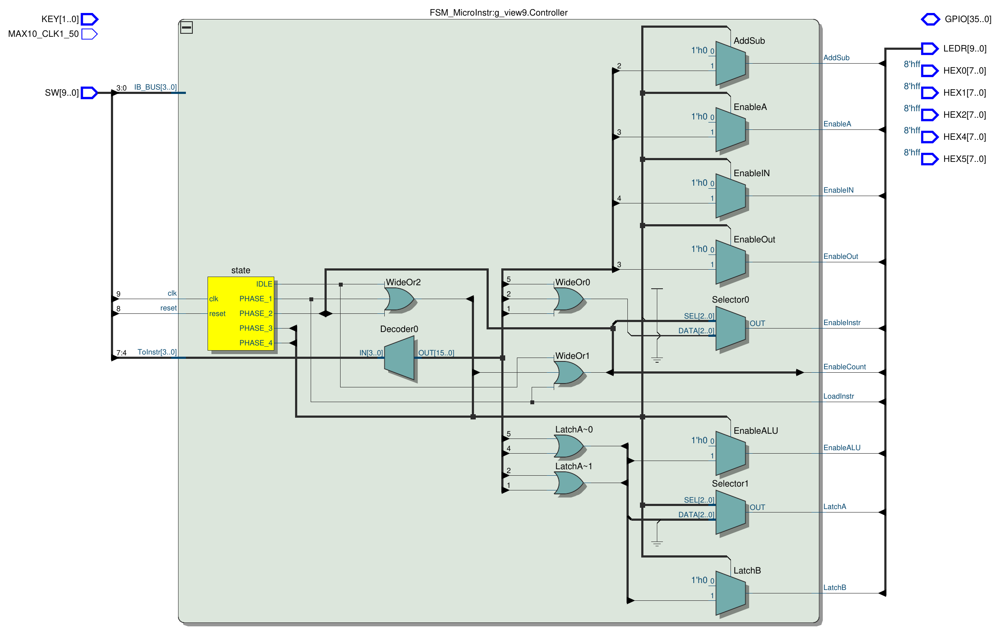<br><em>FSM_MicroInstr RTL Viewer</em></p>

<!-- images/fsm_state_viewer.png : State Machine Viewer -->

### seg7Decoder

Converts a 4 bit value to a hex digit on an active-low 7-segment display (bit 7, the decimal point, stays off). The output is given a default value before the `case` so no latch is inferred. There is one instance per display: HEX0 (bus), HEX1 (A), HEX2 (B), HEX4 (switches) and HEX5 (output register).

**Code**

```verilog
`default_nettype none

module seg7Decoder (
	input [3:0] i_bin,
	output reg [7:0] o_HEX
);

	always @(*) begin
		
		// required to not infer latches
		o_HEX = 8'b11111111;
	
		case(i_bin)
			4'd0: o_HEX = 8'b11000000;
			4'd1: o_HEX = 8'b11111001;
			4'd2: o_HEX = 8'b10100100;
			4'd3: o_HEX = 8'b10110000;
			4'd4: o_HEX = 8'b10011001;
			4'd5: o_HEX = 8'b10010010;
			4'd6: o_HEX = 8'b10000010;
			4'd7: o_HEX = 8'b11111000;
			4'd8: o_HEX = 8'b10000000;
			4'd9: o_HEX = 8'b10011000;
			4'd10: o_HEX = 8'b10001000;
			4'd11: o_HEX = 8'b10000011;
			4'd12: o_HEX = 8'b11000110;
			4'd13: o_HEX = 8'b10100001;
			4'd14: o_HEX = 8'b10000110;
			4'd15: o_HEX = 8'b10001110;
			
		endcase
		
	end

endmodule

`default_nettype wire
```

**Test (instantiation in `main.v`)**

```verilog
seg7Decoder SEG1(
    .i_bin(w_AluA),
    .o_HEX(HEX1)
  );
```

<p align="center">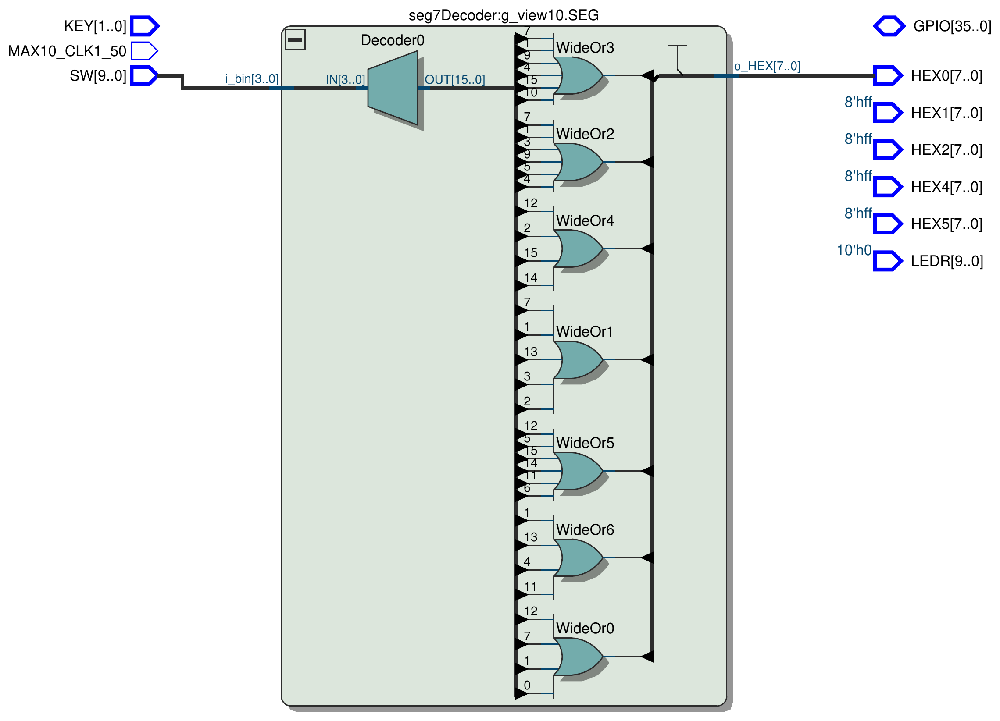<br><em>seg7Decoder RTL Viewer</em></p>

## Verification and validation

Test procedure: run the ROM program on the board by single-stepping the clock switch (`SW[9]`). Each instruction takes 4 clock pulses, so the bus, A, B, input and output displays are checked after every phase.

| Test | Program (ROM address) | Expected | Observed | Pass |
|---|---|---|---|---|
| Load | `LDA 5` (0) | A = 5 (HEX1) | | |
| Add | `ADD 2` (1) | A = 7 | | |
| Output | `OUT` (2) | Out = 7 (HEX5, LEDR[3:0]) | | |
| Subtract | `SUB 8` (3) | A = 1 (8 - 7), LEDR[9] off | | |
| Output | `OUT` (4) | Out = 1 | | |
| Input | `IN` (5), switches = `0010` | A = 2 (HEX4 and HEX1 match) | | |
| Add | `ADD 3` (6) | A = 5 | | |
| Output | `OUT` (7) | Out = 5 | | |
| Wrap | next fetch | PC returns to 0, program repeats | | |
| Reset | `SW[8]` high, one clock | A, B, Out, PC cleared, FSM in `IDLE` | | |

<!-- images/sim_*.png -->

## System working

<!-- board photo: images/board.jpg -->
<!-- video: images/demo.mp4 (link or GIF) -->

## Notes


